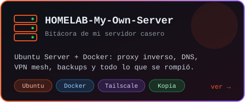
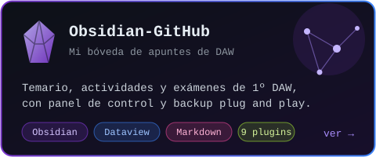
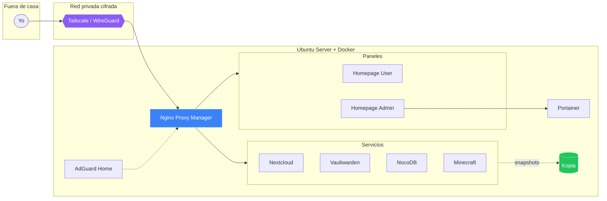
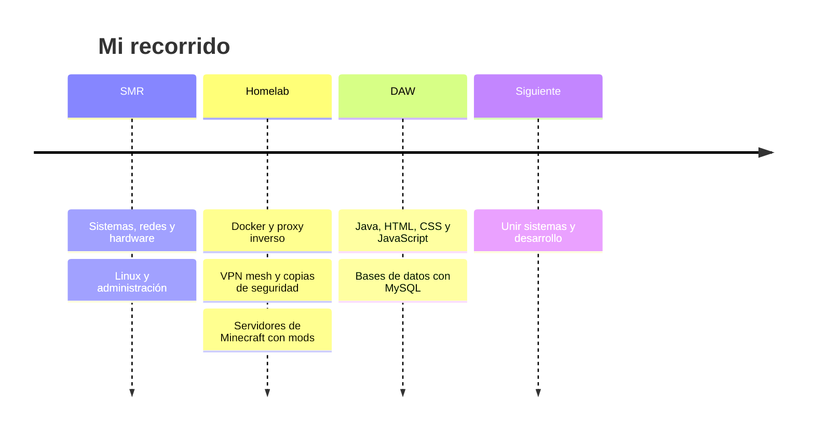
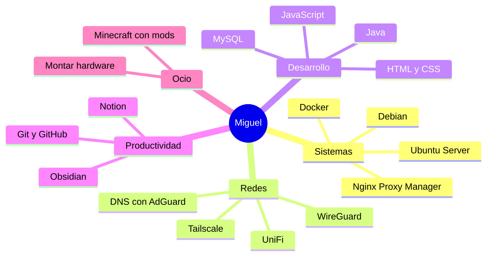

<div align="center">
  
</div>

<div align="center">

[](#)
[](https://github.com/kiravsl2018/Obsidian-GitHub)
[](https://github.com/kiravsl2018/HOMELAB-My-Own-Server)
[](#)
[](#)

</div>

<div align="center">
  
</div>

<br>

<div align="center">
  <a href="#sobre-mi"></a>
  <a href="#proyectos"></a>
  <a href="#skills"></a>
  <a href="#homelab"></a>
  <a href="#camino"></a>
  <a href="#retos-resueltos"></a>
  <a href="#ahora"></a>
</div>

<br>

<div align="center">
  
</div>

<br>


## `~/sobre-mi`



<details>
<summary><b>📄 Ver el JSON como texto</b></summary>

```json
{
  "nombre": "Miguel",
  "roles": ["SysAdmin", "Homelabber", "DAW Developer"],
  "formacion": {
    "titulado": "SMR - Sistemas Microinformáticos y Redes",
    "cursando": "DAW - Desarrollo de Aplicaciones Web"
  },
  "obsesiones": ["Docker", "Linux", "redes", "organización personal"],
  "disfruta": [
    "montar hardware",
    "configurar switches UniFi",
    "optimizar sistemas Linux",
    "administrar servidores de Minecraft con mods"
  ],
  "lema": "romper cosas, arreglarlas y apuntar cómo lo hice"
}
```

</details>

> [!NOTE]
> Todo lo que aprendo en clase lo pruebo después en mi homelab, y todo lo que rompo en el homelab acaba documentado en mis apuntes.


## `~/proyectos`

Los dos repositorios donde vive casi todo lo que hago: uno para lo que monto en casa y otro para lo que aprendo en clase.

<table>
  <tr>
    <td width="50%" valign="top">
      <a href="https://github.com/kiravsl2018/HOMELAB-My-Own-Server"></a>
      <br>
      <b>🖥 <a href="https://github.com/kiravsl2018/HOMELAB-My-Own-Server">HOMELAB-My-Own-Server</a></b><br>
      <sub>El diario de mi servidor con Ubuntu Server y Docker: arquitectura, servicios, cada avería con su causa y su solución, y las lecciones que me dejó. Sin IPs, puertos ni datos de mi red.</sub>
    </td>
    <td width="50%" valign="top">
      <a href="https://github.com/kiravsl2018/Obsidian-GitHub"></a>
      <br>
      <b>💎 <a href="https://github.com/kiravsl2018/Obsidian-GitHub">Obsidian-GitHub</a></b><br>
      <sub>Mi bóveda de Obsidian del Grado Superior en DAW: temario, actividades y exámenes por asignatura, un panel de control hecho con Dataview y un .zip listo para abrir con todos los plugins y estilos.</sub>
    </td>
  </tr>
</table>


## `~/skills`

**💻 Desarrollo**

<p>
  
</p>

**🐧 Sistemas, contenedores y redes**

<p>
  
</p>


**🛠 Herramientas y productividad**

<p>
  
</p>


## `~/homelab`

Un servidor casero sobre **Ubuntu Server** que funciona como mi campo de pruebas.





<details>
<summary><b>📄 Ver la salida como texto</b></summary>

```text
$ docker ps --format "table {{.Names}}\t{{.Image}}"
NAMES                  ROL
nginx-proxy-manager    Proxy inverso
adguard-home           DNS local y filtrado
portainer              Gestión de contenedores
homepage-user          Panel de usuario
homepage-admin         Panel de administración
nextcloud              Nube personal
vaultwarden            Gestor de contraseñas
nocodb                 Bases de datos con interfaz visual
kopia                  Copias de seguridad
minecraft              Servidor con mods
```

</details>

<details>
<summary><b>🎨 Detalle: los dos Homepage con estilo glassmorphism</b></summary>

<br>

Monté **dos paneles** con [Homepage](https://gethomepage.dev/) para separar lo cotidiano de lo crítico:

| Panel | Para qué sirve |
|---|---|
| 🙋 **User** | Accesos a servicios del día a día, sin exponer nada de administración |
| 🛡 **Admin** | Portainer, Kopia, Nginx Proxy Manager, métricas del host y estado de contenedores |

El diseño usa `custom.css` con `backdrop-filter: blur`, bordes translúcidos y tarjetas flotantes. Curiosidad: Homepage está hecha con Next.js, así que no hay ningún `.html` que editar; todo se controla con `.yaml` y CSS.

</details>

> [!TIP]
> La bitácora completa del servidor, con cada fase, los comandos y la tabla de averías, está en **[HOMELAB-My-Own-Server](https://github.com/kiravsl2018/HOMELAB-My-Own-Server)**.


## `~/camino`



<details>
<summary><b>🗺 Ver como diagrama</b></summary>



</details>


## `~/retos-resueltos`

Los errores que más me han enseñado, y cómo salí de ellos:

<details>
<summary><b>🔥 Nginx no arrancaba por un upstream huérfano</b></summary>

<br>

> [!CAUTION]
> Tras reorganizar contenedores, quedó un proxy host apuntando a un servicio de autenticación que ya no existía y Nginx abortaba el arranque.
>
> ```text
> nginx: [emerg] host not found in upstream "authelia"
> ```

> [!TIP]
> **Solución:** probar la configuración con `nginx -t`, renombrar el archivo afectado a `.disabled` y recargar en caliente con `nginx -s reload`.

</details>

<details>
<summary><b>🌐 Conectar a mi red privada desde una red restringida</b></summary>

<br>

> [!CAUTION]
> Desde una red con proxy y cortafuegos fallaron, uno tras otro, la autenticación (403), un registro de nodo duplicado y el DNS.

> [!TIP]
> - **403 en el login:** hacerlo desde otra red o saltarse el navegador con una Auth Key.
> - **`nodekey already exists`:** `tailscale logout` y reautenticar con `--force-reauth`.
> - **Sin internet al conectar:** evitar que la VPN sustituya el DNS con `--accept-dns=false`.

> [!IMPORTANT]
> **Lección:** probar por IP antes que por dominio separa los problemas de red de los de DNS.

</details>

<details>
<summary><b>💾 Que las copias de seguridad no mientan</b></summary>

<br>

> [!WARNING]
> Al mover y borrar carpetas, las políticas de Kopia apuntaban a rutas que ya no existían. Limpié los snapshots huérfanos y lancé uno manual para dejar guardado el estado bueno.

> [!IMPORTANT]
> **Regla:** cada reorganización termina con revisión de rutas y un snapshot manual.

</details>

<details>
<summary><b>🧱 Permisos rotos y base de datos en solo lectura</b></summary>

<br>

> [!CAUTION]
> Borrar carpetas que alojaban volúmenes de Docker dejó a Nginx Proxy Manager con la base de datos en modo lectura (errores 502 y 403).

> [!TIP]
> **Solución:** parar el stack, reajustar propietarios y permisos, limpiar redes huérfanas y volver a levantarlo.

</details>

<details>
<summary><b>📚 Organizar un curso entero sin perder entregas</b></summary>

<br>

> [!NOTE]
> Con ocho asignaturas a la vez necesitaba ver de un vistazo qué tocaba y qué había que entregar. Monté en Obsidian un panel de inicio que lee el horario y las tareas de cada asignatura y me enseña la clase de ahora, la siguiente y lo que vence en las próximas semanas.

> [!TIP]
> **Solución:** una carpeta por asignatura, plantillas para teoría, actividades, prácticas y exámenes, y etiquetas + fechas en cada nota para que el panel lo encuentre todo solo.

</details>

<br>

<sub>📖 Los retos del servidor están contados paso a paso, con los comandos, en la <a href="https://github.com/kiravsl2018/HOMELAB-My-Own-Server#-bitácora">bitácora del homelab</a>.</sub>


## `~/mapa-mental`




## `~/ahora`

<table>
  <tr>
    <td width="33%" align="center" valign="top">
      <h3>📚</h3>
      <b>Estudiando</b>
      <br><br>
      Grado Superior en <b>DAW</b>
    </td>
    <td width="33%" align="center" valign="top">
      <h3>🔬</h3>
      <b>Practicando</b>
      <br><br>
      Docker, redes, VPN y backups en mi <a href="https://github.com/kiravsl2018/HOMELAB-My-Own-Server">homelab</a>
    </td>
    <td width="33%" align="center" valign="top">
      <h3>🧠</h3>
      <b>Organizando</b>
      <br><br>
      Apuntes en <b><a href="https://github.com/kiravsl2018/Obsidian-GitHub">Obsidian</a></b> y bases de datos en <b>Notion</b>
    </td>
  </tr>
</table>


## `~/actividad`

<picture>
  <source media="(prefers-color-scheme: dark)" srcset="https://raw.githubusercontent.com/kiravsl2018/kiravsl2018/output/github-snake-dark.svg" />
  <source media="(prefers-color-scheme: light)" srcset="https://raw.githubusercontent.com/kiravsl2018/kiravsl2018/output/github-snake.svg" />
  
</picture>

<br>

<div align="center">
  <sub>💜 Gracias por pasarte por mi perfil · Siempre aprendiendo, siempre rompiendo y arreglando cosas</sub>
</div>

<div align="center">
  
</div>
